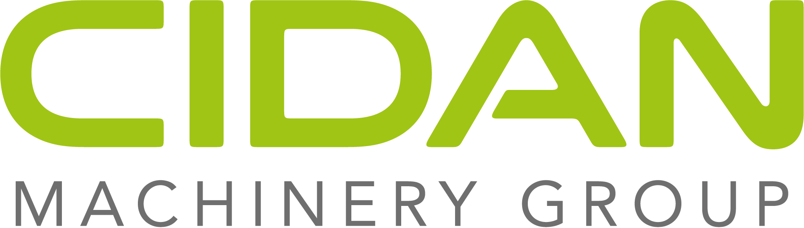

  

# CIDAN Machinery Internal Tooling

  

Tools and integrations maintained by CIDAN IT to make everyday work simpler and keep connected systems working together.

## What we build

- Internal applications that bring common IT tasks into one place
- Integrations between business systems, including Zoho and Jeeves
- Focused utilities and automation for recurring workflows
- Shared components and development foundations for new tools

Each project keeps its purpose, access requirements, and getting-started guidance in its own README. Detailed maintenance instructions live with the relevant repository.

## How we work

CIDAN IT uses GitHub, Copilot, and other AI tools to support scripting, documentation, and automation. Repository-specific guidance and review requirements apply to contributions.

[Technical documentation](../.agents/README.md)

## Help and Support

Looking for help? Please open a ticket with IT: [it-general@cidanmachinery.com](mailto:it-general@cidanmachinery.com).
